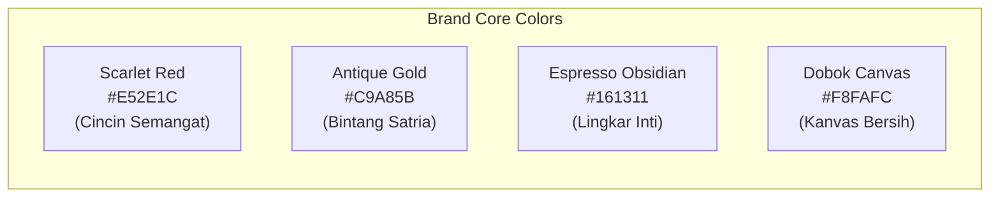
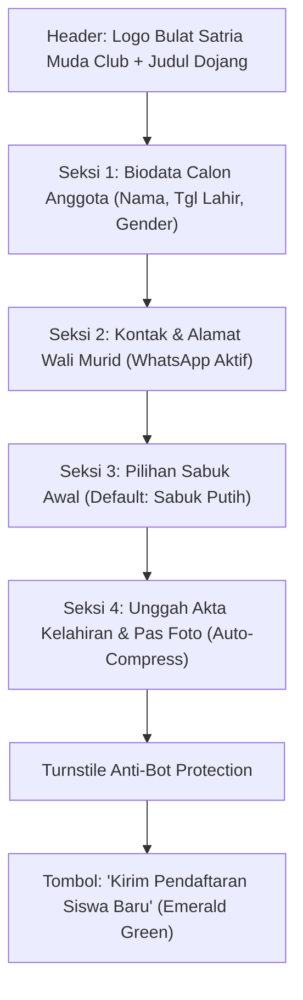
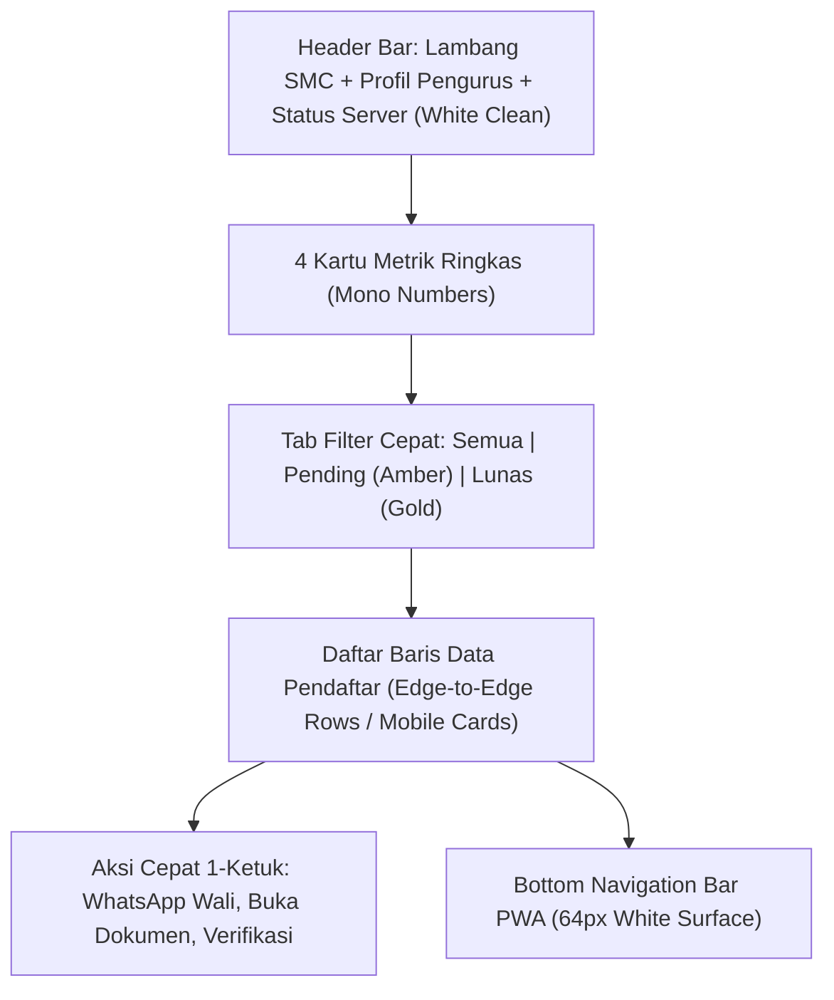

# Design System & Brand Identity: Taekwondo Satria Muda Club

**Identitas Resmi:** Taekwondo Satria Muda Club (SMC)  
**Format Target:** Progressive Web Application (PWA) & Mobile-First Responsive Web  
**Filosofi Visual:** *Satria's Spirit: Martial Precision, Crimson Honor & Golden Excellence*  
**Versi Dokumen:** 2.0.0 (Logo & Brand Calibrated)  
**Status:** Approved for Implementation  
**Aset Referensi Logo:** `docs/logo-satria-muda.png`  

---

## 1. Analisis Visual Logo & Filosofi Brand


Logo resmi **Taekwondo Satria Muda Club** memiliki komposisi emblem lingkaran (*roundel patch*) berkarakter kuat dengan makna filosofis mendalam:

```
[Anatomi Visual Emblem Satria Muda Club]
├── Cincin Luar (Scarlet Red Ring)      : Keberanian pantang menyerah, gairah muda, & energi dinamis Taekwondo.
├── Tipografi Lingkar (TAEKWONDO)       : Huruf kapital hitam tegas ber-tracking lebar diapit 2 bintang pemisah.
├── Lingkaran Dalam (Espresso Obsidian) : Kedisiplinan, ketenangan batin, fondasi sabuk hitam, & kehormatan dojang.
└── Bintang Segi 8 (Antique Gold Star)  : 8 Arah mata angin & 8 Janji/Nilai Luhur Taekwondo (Kehormatan,
                                          Integritas, Ketekunan, Pengendalian Diri, Semangat Pantang Menyerah,
                                          Kedisiplinan, Jiwa Satria, & Loyalitas).
```

### Kalibrasi Atmosfer UI
- **Public Registration Form (`/`):** Terang, bersih, berwibawa (*Dobok White Canvas*). Memberikan impresi profesional dan ramah bagi calon murid dan orang tua, dengan tombol aksi submit hijau mantap (*Emerald Green #059669*) yang melambangkan pertumbuhan, awal positif, dan verifikasi aman.
- **Admin PWA App Shell (`/admin/*`):** Mode terang bersih & presisi (*Dobok Canvas #F8FAFC & Pure White Surface*), dipadukan dengan aksen *Antique Dark Gold* (#8C6918 / #C9A85B) untuk penanda navigasi aktif (*navitems*), verifikasi prestasi/status anggota, serta tombol submit formulir berwarna hijau (*Emerald Green*).

---

## 2. Calibrated Color Palette

Warna diekstraksi langsung dari elemen pigmen logo resmi dan dikalibrasikan untuk standar keterbacaan WCAG AA/AAA:



### 2.1 Palet Utama (Brand Core Tokens)

| Token Nama | Hex Code | Deskripsi & Peran Fungsional |
| :--- | :--- | :--- |
| `color-satria-red` | `#E52E1C` | **Warna Brand Utama.** Diambil dari cincin luar logo. Digunakan untuk tombol submit utama, penanda penting, badge navigasi aktif, dan elemen penarik perhatian. |
| `color-satria-red-hover` | `#C42010` | Status hover dan interaksi aktif dari tombol utama. |
| `color-satria-gold` | `#C9A85B` | **Warna Lambang Kehormatan.** Diambil dari bintang segi-8 logo. Digunakan untuk lencana verifikasi, bintang sabuk, kartu metrik prestasi, dan watermark cetak. |
| `color-satria-gold-subtle` | `rgba(201, 168, 91, 0.14)` | Latar belakang lencana status anggota kehormatan dan chip tingkatan sabuk. |
| `color-dobok-canvas` | `#F8FAFC` | Kanvas latar belakang utama (Slate-50) untuk formulir pendaftaran dan panel admin. |
| `color-dobok-surface` | `#FFFFFF` | Latar kartu dashboard, tabel, modal, dan bilah navigasi admin. |
| `color-dobok-border` | `#E2E8F0` | Garis pembatas panel, kartu, dan input form (Slate-200). |

### 2.2 Tema Terang Antarmuka Admin & Registrasi (Light Mode)
Digunakan pada seluruh halaman publik dan panel admin agar lapang, berwibawa, dan memiliki kontras tinggi saat digunakan di dalam maupun luar ruangan:

| Token Nama | Hex Code | Peran Fungsional |
| :--- | :--- | :--- |
| `color-canvas-light` | `#F8FAFC` | Kanvas latar belakang utama (putih dobok bersih). |
| `color-surface-light` | `#FFFFFF` | Latar kontainer formulir, panel data, modal, dan bottom nav. |
| `color-ink-primary` | `#0F172A` | Teks judul utama, nama pendaftar, dan angka nominal (Slate-900). |
| `color-ink-secondary` | `#475569` | Label form, navigasi, dan informasi pendukung (Slate-600). |
| `color-ink-muted` | `#64748B` | Teks keterangan, placeholder, dan metadata (Slate-500). |
| `color-border-light` | `#E2E8F0` | Border kotak masukan dan pembatas baris data (Slate-200). |
| `color-border-focus` | `#E52E1C` | Border aktif bernuansa merah Satria saat kolom sedang diisi. |

### 2.3 Status Semantik (Data Badges Light Mode)

| Status | Latar Belakang | Teks Indikator | Makna Sistem |
| :--- | :--- | :--- | :--- |
| **Verified / Paid** | `#FEF3C7` (Amber-50) | `#8C6918` (Antique Gold Dark) | Anggota resmi terverifikasi / Pembayaran lunas tercatat. |
| **Pending Review** | `#FEF3C7` (Amber-50) | `#B45309` (Amber-700) | Berkas pendaftar baru belum divalidasi admin. |
| **Unpaid / Warning** | `#FEF2F2` (Red-50) | `#E52E1C` (Satria Red) | Pendaftaran diverifikasi tetapi belum melunasi biaya iuran. |
| **Rejected** | `#F1F5F9` (Slate-100) | `#475569` (Slate-600) | Berkas pendaftaran ditolak / dibatalkan. |

---

## 3. Typographic Architecture

Tipografi mencerminkan ketegasan tulisan **"TAEKWONDO SATRIA MUDA CLUB"** pada logo: geometris, kokoh, dan berjarak lega (*tracked*):

### 3.1 Font Stacks Terpilih
1. **Display & Brand Headlines:** `Cabinet Grotesk` atau `Satoshi` (Weight: 700 / 800)
   - Karakter huruf tegas, berbobot atletis, cocok dipadukan dengan lambang bintang segi-8.
2. **Interface & Running Text:** `Plus Jakarta Sans` atau `Geist Sans` (Weight: 400 / 500 / 600)
   - Keterbacaan optimal pada layar ponsel kecil saat pengisian formulir.
3. **Data & Identitas Unik:** `Geist Mono` atau `JetBrains Mono` (Weight: 600)
   - Khusus untuk Kode Registrasi (`TKD-202611-001`), nominal pembayaran Rupiah (`Rp 250.000`), dan tanggal.

### 3.2 Spesifikasi Skala Tipe

```css
/* Aturan Tipografi Utama */
--font-brand: 'Cabinet Grotesk', -apple-system, sans-serif;
--font-body: 'Plus Jakarta Sans', -apple-system, sans-serif;
--font-mono: 'Geist Mono', monospace;

/* Batasan Skala Judul: Maksimal 2 Baris pada Seluruh Viewport */
.hero-title {
  font-family: var(--font-brand);
  font-size: clamp(2rem, 5.5vw, 3.25rem);
  font-weight: 800;
  line-height: 1.08;
  letter-spacing: -0.025em;
  color: var(--color-ink-primary);
}

.brand-badge-title {
  font-family: var(--font-brand);
  text-transform: uppercase;
  letter-spacing: 0.12em; /* Mengikuti lekuk tulisan pada logo */
  font-size: 0.8125rem;
  font-weight: 700;
}
```

---

## 4. Brand Motifs & Component Blueprint

### 4.1 Motif Khas: *The 8-Pointed Star of Satria*
Bintang segi-8 dari logo dijadikan elemen pengenal unik (*brand signature*) di seluruh sistem:

1. **Favicon & PWA Launcher Icon:**
   - Ikon aplikasi PWA di layar ponsel menggunakan emblem logo penuh atau siluet bintang emas segi-8 di atas kanvas hitam obsidian bertepi merah.
2. **Watermark Bukti Registrasi (`/success`):**
   - Halaman konfirmasi sukses menampilkan siluet vektor bintang segi-8 semi-transparan (opasitas 6%) di belakang nomor registrasi pendaftar.
3. **Kop Laporan Resmi PDF:**
   - Header PDF dan Excel mencantumkan logo resmi Satria Muda Club di pojok kiri atas dan stempel bintang pada kolom pengesahan pengurus.

---

### 4.2 Komponen Tombol & Aksi (Button System)
- **Submit Actions (Primary Form Submit):**
  - Background: `bg-emerald-600 hover:bg-emerald-700` (`#059669` / `#047857`).
  - Text: `#FFFFFF` (Bold 600/700, letter-spacing `0.02em`).
  - Radius: `8px` untuk form utama, `6px` untuk modal form.
  - Interaksi: Saat disentuh jempol (*active state*), tombol bergeser `1px` ke bawah (`transform: translateY(1px)`) dengan umpan balik instan.
- **Brand Action & Accent Buttons:**
  - Background: `var(--color-satria-red)` (`#E52E1C`) untuk penanda navigasi dan aksi khusus.
- **Secondary / Action Button:**
  - Background: Transparan / `bg-slate-100` dengan border `1px solid #CBD5E1`.
  - Text: `text-slate-700`.

---

### 4.3 Formulir Registrasi Publik (`/`)



- **Ukuran Input:** Tinggi `48px` untuk setiap field (memenuhi standar aksesibilitas jempol).
- **Kompresor Berkas:** Tampilan interaktif yang menginformasikan penghematan kuota secara transparan:
  `"Foto Akta berhasil dioptimasi: 3.2 MB -> 380 KB (Kualitas Jernih)"`.

---

### 4.4 Panel Admin PWA Mobile-First (`/admin/*`)



#### Navigasi Bawah Admin (PWA Bottom Bar)
Pada smartphone admin, bilah navigasi diletakkan di bawah layar setinggi `64px` dengan latar `#FFFFFF` (Pure Surface), bayangan halus, dan pembatas atas tipis berwarna Slate-200:
1. **Beranda:** Ikon Dashboard KPI.
2. **Pendaftar:** Ikon Daftar Pendaftar Baru (dengan lencana angka pendaftar *pending* warna merah).
3. **Anggota:** Ikon Master Anggota Aktif.
4. **Pembayaran:** Ikon Status Bayar.
5. **Laporan:** Ikon Cetak Excel & PDF.

#### Aturan Ketat UI Mobile (No Text Wrapping & Proportional Hierarchy)
1. **No Awkward Text Wrapping:** Seluruh elemen identifikasi kritis (Kode Registrasi `TKD-xxx`, Nominal Pembayaran `Rp xxx`, Tanggal `YYYY-MM-DD`, Nomor WhatsApp, Lencana Status, dan label tombol aksi) WAJIB menggunakan `whitespace-nowrap` agar tidak patah antar kata pada layar kecil.
2. **Dedicated Mobile Cards:** Pada resolusi ponsel (`< 768px`), tabel lebar digantikan dengan kartu data proporsional tepi-ke-tepi (*edge-to-edge cards*) sehingga admin tidak perlu melakukan *horizontal scroll* kikuk untuk melihat aksi atau status pendaftar.
3. **Hierarki Tipografi Terkalibrasi:**
   - Judul Halaman: `text-xl sm:text-2xl font-extrabold text-slate-900`
   - Label & Badge: `text-[10px] sm:text-[11px] font-bold uppercase tracking-wider`
   - Body & Nama Siswa: `text-sm font-semibold text-slate-900 truncate`
   - Data Monospace: `font-mono text-xs sm:text-sm`
   - Meta & Keterangan: `text-xs text-slate-500`

---

### 4.5 Pratinjau Dokumen Privat (The Dojo Darkroom)
- Saat admin menekan tombol *"Lihat Akta"*, layar membuka panel *Slide-Over* dengan kontainer gambar hitam pekat (`#020617` / Slate-950) agar kontras foto dokumen akta kelahiran tetap optimal dan jernih.
- Panel informasi di sebelah kanan dokumen menggunakan tema terang (`#FFFFFF` dengan teks `Slate-900` dan label `Slate-500`) yang serasi dengan antarmuka admin.
- Dokumen foto akta kelahiran ditampilkan dengan kontrol sentuh:
  - Tombol Putar Dokumen (*Rotate 90°*).
  - Tombol Zoom (*Zoom In / Zoom Out / Reset Transform*).
  - Panel info pendaftar di samping berkas dengan tombol cepat *"Verifikasi Berkas Sekarang"* berwarna Satria Red (`#E52E1C`).

---

## 5. Layout & Responsive Architecture

- **Max Container:** `1360px` di desktop, terpusat rapi.
- **Grid Laporan & Dashboard Admin:** Menggunakan CSS Grid fleksibel yang bertransisi ke kartu vertikal ringkas di bawah resolusi `768px`.
- **Zero Horizontal Overflow:** Tidak ada toleransi untuk pergeseran horizontal (*horizontal scroll*) liar pada layar ponsel.
- **PWA Safe Area:** Memperhitungkan `env(safe-area-inset-top)` dan `env(safe-area-inset-bottom)` pada perangkat iPhone berponi (*notch / Dynamic Island*).

---

## 6. Motion Philosophy: *Snappy Martial Reflex*

- **Durasi Animasi:** `160ms`–`220ms` (respons cepat mencerminkan refleks atlet bela diri).
- **Kurva Gerak:** `cubic-bezier(0.16, 1, 0.3, 1)` (cepat saat meluncur, berhenti mantap dan presisi).
- **Larangan Gerak:**
  - Dilarang membuat teks melayang atau bayangan berkedip terus-menerus.
  - Wajib menghormati preferensi OS via media query `@media (prefers-reduced-motion: reduce)`.

---

## 7. Anti-Patterns & Aturan Wajib (Brand Discipline)

| Pola Terlarang | Alasan Pelanggaran Brand | Pengganti yang Wajib Digunakan |
| :--- | :--- | :--- |
| **Gradien Ungu / Biru Neon** | Bertentangan dengan identitas merah-emas-hitam Satria Muda Club. | Gunakan palet solid terkalibrasi (*Satria Red, Antique Gold, Espresso Obsidian*). |
| **Meratakan Semua Teks ke Tengah (Centered Layout Cliché)** | Mengurangi kesan ketegasan dan keterbacaan instruksi. | Gunakan format rata kiri (*left-aligned*) dengan hierarki yang jelas. |
| **Mengubah Bentuk/Warna Logo Resmi** | Melanggar integritas lambang resmi perguruan/klub. | Selalu gunakan file logo asli `docs/logo-satria-muda.png` dengan aspek rasio 1:1. |
| **Menghapus Tulisan Lengkap Brand** | Mengaburkan nama sah organisasi olahraga. | Cantumkan nama lengkap: **Taekwondo Satria Muda Club** pada header publik dan dokumen resmi. |
| **Card Soup di Dashboard Admin** | Menghamburkan ruang layar HP saat admin butuh memantau puluhan nama. | Gunakan format *Edge-to-Edge Data Rows* bergaris pemisah halus. |
| **Tombol Kapsul Bulat Penuh (Pill Buttons)** | Terkesan kasual dan main-main, tidak cocok dengan tema martial arts. | Gunakan tombol dengan sudut terpotong rapi (*corner radius 6px*). |

---

## 8. Panduan Integrasi Aset Logo

1. **Aset Header Web Publik:**
   - Letak: Sudut kiri atas dengan tinggi proporsional `48px`–`56px`, bersanding dengan teks *"TAEKWONDO SATRIA MUDA CLUB"*.
2. **Aset PWA Web Manifest (`vite.config.js`):**
   - Menghasilkan ikon turunan: `icon-192x192.png`, `icon-512x512.png`, dan `maskable-icon-512x512.png` langsung dari lambang logo pusat.
3. **Ekspor PDF Laporan:**
   - Logo disematkan beresolusi tajam (*high-DPI*) pada pojok kiri atas kop surat rekapitulasi data anggota dan status iuran bulanan.
