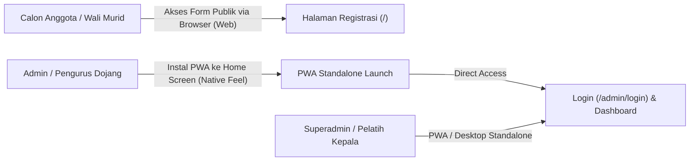
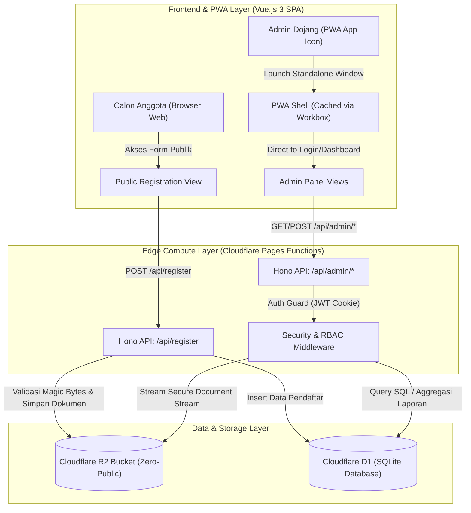
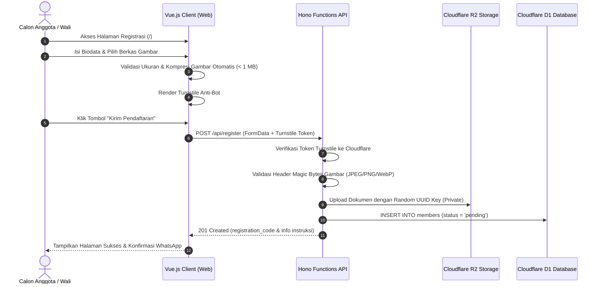
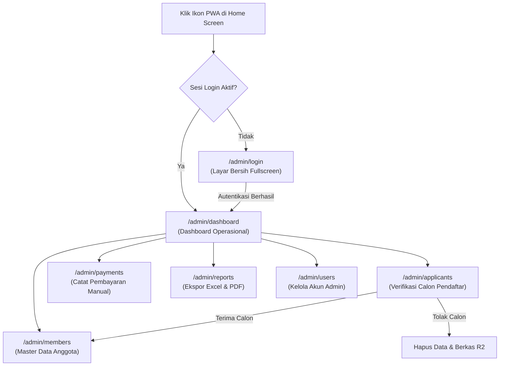
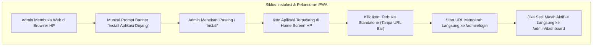
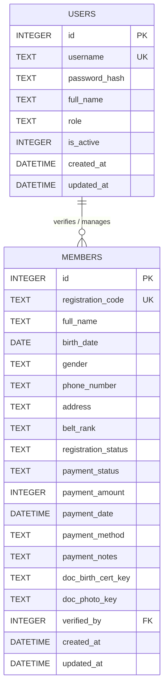
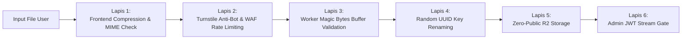
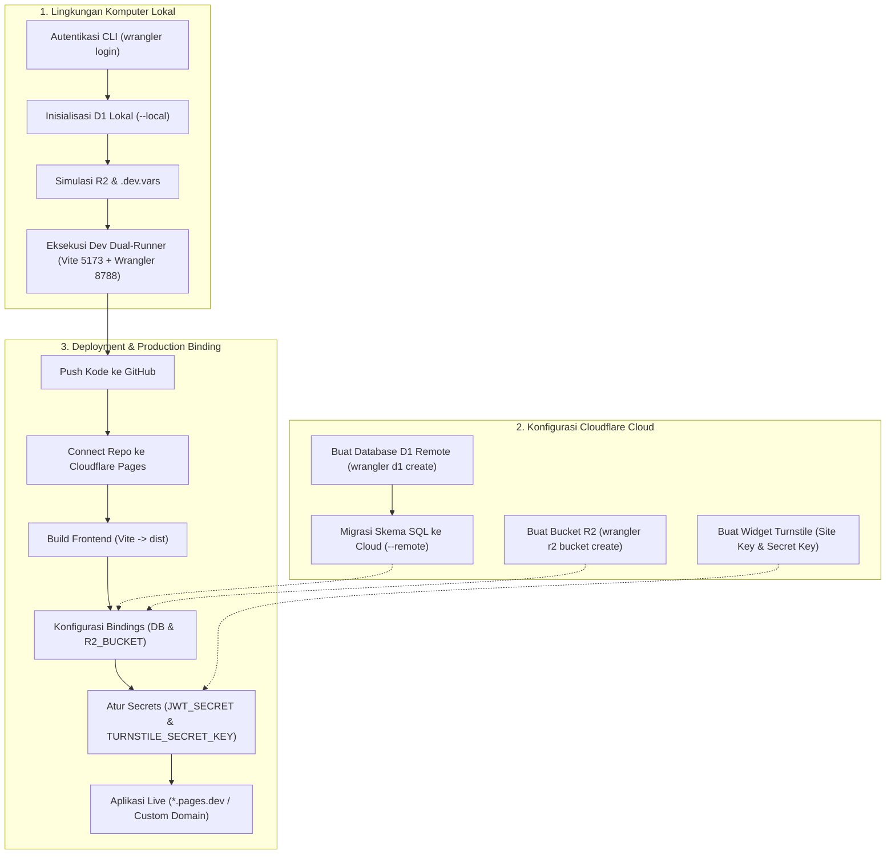

# Product Requirements Document (PRD)

**Nama Proyek:** Taekwondo Satria Muda Club (SMC) Registration & Member Management System  
**Format Aplikasi:** Progressive Web Application (PWA) & Mobile-First Responsive SPA  
**Dokumen Versi:** 1.2.0 (Brand Synchronized)  
**Status:** Ready for Development  
**Target Rilis:** Q4 2026  

---

## Daftar Isi
1. [Gambaran Umum & Tujuan Sistem](#1-gambaran-umum--tujuan-sistem)
   - [1.1 Ringkasan Eksekutif](#11-ringkasan-eksekutif)
   - [1.2 Problem Statement & Solusi](#12-problem-statement--solusi)
   - [1.3 Tujuan Sistem (Key Objectives)](#13-tujuan-sistem-key-objectives)
   - [1.4 Target Pengguna (User Personas)](#14-target-pengguna-user-personas)
2. [Analisis Arsitektur & Tech Stack](#2-analisis-arsitektur--tech-stack)
   - [2.1 Komparasi: Cloudflare Ecosystem vs. Firebase](#21-komparasi-cloudflare-ecosystem-vs-firebase)
   - [2.2 Arsitektur Sistem Terpilih](#22-arsitektur-sistem-terpilih)
   - [2.3 Spesifikasi Teknologi](#23-spesifikasi-teknologi)
3. [Fitur Utama & Alur Kerja (User Flow)](#3-fitur-utama--alur-kerja-user-flow)
   - [3.1 Alur Publik: Registrasi Calon Anggota (Mobile-First)](#31-alur-publik-registrasi-calon-anggota-mobile-first)
   - [3.2 Alur Administrator: Panel Manajemen Terpusat](#32-alur-administrator-panel-manajemen-terpusat)
   - [3.3 Spesifikasi Progressive Web App (PWA) & Native Experience](#33-spesifikasi-progressive-web-app-pwa--native-experience)
4. [Desain Skema Database (Cloudflare D1 - SQL)](#4-desain-skema-database-cloudflare-d1---sql)
   - [4.1 Entity Relationship Diagram (ERD)](#41-entity-relationship-diagram-erd)
   - [4.2 Skema Tabel DDL](#42-skema-tabel-ddl)
5. [Struktur Folder & Konfigurasi Proyek](#5-struktur-folder--konfigurasi-proyek)
   - [5.1 Struktur Monorepo Cloudflare Pages](#51-struktur-monorepo-cloudflare-pages)
   - [5.2 Konfigurasi PWA pada `vite.config.js`](#52-konfigurasi-pwa-pada-viteconfigjs)
   - [5.3 Konfigurasi Binding `wrangler.toml`](#53-konfigurasi-binding-wranglertoml)
6. [Spesifikasi Keamanan (Security Architecture)](#6-spesifikasi-keamanan-security-architecture)
   - [6.1 Validasi Ketat Upload File & Cek Magic Bytes](#61-validasi-ketat-upload-file--cek-magic-bytes)
   - [6.2 Proteksi Dokumen Privat (Zero-Public R2 Bucket)](#62-proteksi-dokumen-privat-zero-public-r2-bucket)
   - [6.3 Pencegahan SQL Injection (Parameterized Queries)](#63-pencegahan-sql-injection-parameterized-queries)
   - [6.4 Proteksi Anti-Bot, DDoS, & Rate Limiting](#64-proteksi-anti-bot-ddos--rate-limiting)
   - [6.5 Keamanan Autentikasi & Penyimpanan Sesi](#65-keamanan-autentikasi--penyimpanan-sesi)
   - [6.6 Sanitasi Input & XSS Prevention](#66-sanitasi-input--xss-prevention)
7. [Tahapan Integrasi Cloudflare & Deployment (End-to-End)](#7-tahapan-integrasi-cloudflare--deployment-end-to-end)
   - [7.1 Roadmap Integrasi Cloudflare Terpadu](#71-roadmap-integrasi-cloudflare-terpadu)
   - [7.2 Langkah 1: Persiapan CLI & Autentikasi Cloudflare](#72-langkah-1-persiapan-cli--autentikasi-cloudflare)
   - [7.3 Langkah 2: Setup Database Cloudflare D1 (Lokal & Remote)](#73-langkah-2-setup-database-cloudflare-d1-lokal--remote)
   - [7.4 Langkah 3: Setup Object Storage Cloudflare R2](#74-langkah-3-setup-object-storage-cloudflare-r2)
   - [7.5 Langkah 4: Setup Proteksi Anti-Bot Cloudflare Turnstile](#75-langkah-4-setup-proteksi-anti-bot-cloudflare-turnstile)
   - [7.6 Langkah 5: Standarisasi Variabel Lingkungan & Secret (.env & .dev.vars)](#76-langkah-5-standarisasi-variabel-lingkungan--secret-env--devvars)
   - [7.7 Langkah 6: Eksekusi Local Development Bebas Error (Vite + Wrangler)](#77-langkah-6-eksekusi-local-development-bebas-error-vite--wrangler)
   - [7.8 Langkah 7: Deployment ke Cloudflare Pages via Git Repository](#78-langkah-7-deployment-ke-cloudflare-pages-via-git-repository)
   - [7.9 Langkah 8: Konfigurasi Bindings & Secrets di Dashboard Cloudflare](#79-langkah-8-konfigurasi-bindings--secrets-di-dashboard-cloudflare)
   - [7.10 Panduan Troubleshooting & Kriteria Keberhasilan (Definition of Done)](#710-panduan-troubleshooting--kriteria-keberhasilan-definition-of-done)

---

## 1. Gambaran Umum & Tujuan Sistem

### 1.1 Ringkasan Eksekutif
Aplikasi web berbasis **Progressive Web Application (PWA)** dan *Single Page Application (SPA)* yang dirancang untuk memfasilitasi pendaftaran anggota baru tempat pelatihan Taekwondo (Dojang). Pendaftar dapat mendaftar langsung secara instan tanpa perlu registrasi/pembuatan akun (*zero-friction registration*).

Untuk pengurus dojang (admin), sistem dapat diinstalasi langsung ke layar utama (*Add to Home Screen*) pada perangkat Android, iOS, maupun Desktop layaknya aplikasi native. Saat dibuka oleh admin, aplikasi langsung meluncur (*standalone window*) ke halaman login dan dashboard tanpa bilah navigasi peramban (*browser address bar*), menghadirkan pengalaman pengguna yang cepat, terdedikasi, dan intuitif. Panel admin menyediakan fitur validasi calon pendaftar, pratinjau dokumen privat, pencatatan status pembayaran manual, manajemen multi-user admin, serta ekspor laporan resmi ke format PDF dan Excel.

### 1.2 Problem Statement & Solusi

| Kondisi Eksisting / Kendala | Dampak Negatif | Solusi Sistem Baru |
| :--- | :--- | :--- |
| **Akses Admin Terasa Lambat & Terbuka di Tab Browser Biasa** | Admin harus membuka browser, mengetikkan URL, dan terganggu oleh banyak tab peramban yang sedang terbuka. | **PWA Standalone App**: Admin menginstal sistem ke Home Screen/Desktop; membuka sekali sentuh langsung ke layar login/dashboard tanpa bilah browser. |
| **Pengumpulan Berkas via Chat WhatsApp / Kertas Fisik** | Foto Akta Kelahiran dan KK tercecer di galeri HP pengurus, rentan hilang, dan tidak terorganisir. | Penyimpanan berkas digital terpusat di Cloudflare R2 dengan enkripsi saat transit dan kontrol akses ketat. |
| **Pendaftaran Terhalang Kewajiban Bikin Akun** | Calon murid/orang tua malas mendaftar bila harus verifikasi email/password terlebih dahulu (*drop-off rate* tinggi). | **Zero-Friction Registration**: Form langsung isi dan submit dari HP dalam < 3 menit tanpa membuat akun. |
| **Pencatatan Keuangan & Iuran Manual Tidak Terpusat** | Sering terjadi salah catat status pembayaran antara pendaftaran dan iuran bulanan. | Modul verifikasi pembayaran manual dengan pencatatan nominal, tanggal bayar, metode, dan status konfirmasi. |
| **Pelaporan Lambat & Repot** | Pengurus harus menyalin data satu per satu saat membutuhkan rekap data anggota baru. | Ekspor otomatis rekap data ke file **Excel (.xlsx)** dan **PDF tabel resmi** langsung dari browser admin. |

### 1.3 Tujuan Sistem (Key Objectives)
- **Native-Like Admin Experience (PWA):** Pengurus dapat memasang aplikasi ke layar utama (*Home Screen*) ponsel Android/iPhone atau Desktop. Saat di-launch, aplikasi terbuka secara instan (*instant launch* melalui caching Service Worker) dengan orientasi *standalone* langsung mengarah ke gerbang login/dashboard admin.
- **Zero-Friction Registration:** Calon anggota atau orang tua murid dapat mengisi formulir dan mengunggah dokumen persyaratan (Akta Kelahiran, KK/KTP, Pas Foto) dari smartphone dalam kurun waktu kurang dari 3 menit tanpa login/registrasi akun.
- **Sentralisasi & Keamanan Dokumen:** Mengamankan berkas identitas calon anggota ke penyimpanan *private cloud storage* yang hanya dapat dialirkan (*streamed*) ke sesi admin yang telah terautentikasi.
- **Efisiensi Operasional Pengurus:** Memangkas waktu verifikasi berkas pendaftar baru, mempercepat pembaruan status keanggotaan, pencatatan pembayaran tunai/transfer, serta penerbitan laporan berkala.

### 1.4 Target Pengguna (User Personas)



1. **Calon Anggota / Wali Murid:**
   - Mengakses via peramban mobile smartphone melalui tautan/link pendaftaran langsung atau pemindaian QR code di dojang.
   - Mengisi biodata dan mengunggah dokumen persyaratan dengan kompresi otomatis client-side.
2. **Administrator / Pengurus Dojang:**
   - Menggunakan aplikasi via PWA yang terinstal di layar utama smartphone atau tablet.
   - Masuk langsung ke `/admin/login` tanpa mengetik URL, melakukan verifikasi berkas, mengubah status pendaftaran, serta mencatat transaksi pembayaran tunai/transfer di lapangan.
3. **Superadmin / Pelatih Kepala:**
   - Mengakses via tablet, laptop, atau smartphone dalam mode PWA Standalone.
   - Memiliki kendali penuh atas sistem, termasuk pembuatan, reset password, dan aktivasi/deaktivasi akun admin lain.

---

## 2. Analisis Arsitektur & Tech Stack

### 2.1 Komparasi: Cloudflare Ecosystem vs. Firebase

Pemilihan stack teknologi berbasis ekosistem **Cloudflare (Pages Functions + D1 + R2)** didasarkan pada perbandingan objektif berikut:

| Kriteria Evaluasi | Cloudflare Stack (D1 + R2 + Pages) | Firebase Stack (Auth + Firestore + Storage) | Kesimpulan & Pemenang |
| :--- | :--- | :--- | :--- |
| **CRUD Akun Admin & Multi-User** | **Sangat Fleksibel & Gratis.** Tabel `users` dikelola sendiri di SQLite (D1). Admin utama bebas tambah/edit/hapus akun admin lain tanpa mengganggu sesi login yang aktif. | **Rumit / Berbayar.** Membuat user baru via Client SDK Firebase Auth otomatis me-logout sesi aktif saat ini, kecuali memakai Firebase Admin SDK di Cloud Functions (wajib Blaze Plan berbayar). | **Cloudflare Unggul** (bebas biaya & arsitektur sederhana). |
| **Penyimpanan Dokumen Privat (Privasi Data)** | **Gratis Egress & Terisolasi Penuh.** Cloudflare R2 menyediakan 10 GB gratis/bulan dengan **Rp 0 biaya egress**. Bucket dibuat 100% *Private* dan file hanya disajikan lewat Worker API yang memvalidasi JWT. | **Biaya Egress & Aturan Rumit.** Firebase Storage mengenakan biaya egress setelah kuota harian habis. Aturan Security Rules Firebase sering bocor jika salah konfigurasi. | **Cloudflare Unggul** (keamanan privat tanpa biaya tak terduga). |
| **Model Data & Kemudahan Reporting** | **Relasional (SQL).** Memakai Cloudflare D1 (SQLite). Sangat efisien untuk query relasi, aggregasi, filter rentang tanggal, status pembayaran, dan ekspor data tabular. | **NoSQL Document Store (Firestore).** Query filter majemuk (*compound query*) terbatas, membutuhkan multi-field index manual, dan aggregasi data lebih kompleks. | **Cloudflare Unggul** (fleksibilitas SQL untuk laporan). |
| **Dukungan PWA & Caching Edge** | Aset static PWA di-*cache* dan disajikan dari Cloudflare Global CDN dengan header cache HTTP/3 ultra-cepat. | Hosting Firebase standar berbasis CDN regional. | **Cloudflare Unggul** (performa delivery PWA instan). |

### 2.2 Arsitektur Sistem Terpilih



### 2.3 Spesifikasi Teknologi

- **Frontend Framework:** Vue.js 3 (Composition API dengan `<script setup>`).
- **PWA Engine & Tooling:** `vite-plugin-pwa` berbasis Google Workbox.
  - Mode registrasi Service Worker: `autoUpdate` (otomatis memperbarui aplikasi saat ada rilis baru).
  - Caching App Shell: Pra-cache aset HTML, CSS, JS, dan webfont lokal untuk waktu buka instan.
- **Build Tooling:** Vite (performa kompilasi super cepat dan HMR instan).
- **Styling:** Tailwind CSS (desain utilitas responsif, *mobile-first*) didukung Iconify / Lucide Icons.
- **Backend Runtime:** Cloudflare Pages Functions (Edge Serverless).
- **Web API Framework:** [Hono](https://hono.dev/) (framework web ultra-ringan dengan routing standar Web Standards).
- **Database Engine:** Cloudflare D1 (Serverless relational database berbasis SQLite).
- **Object Storage:** Cloudflare R2 (Object storage kompatibel S3, zero-egress fee, mode *zero-public*).
- **Authentication:** Custom JWT (JSON Web Token) yang disimpan dalam `HttpOnly, Secure, SameSite=Strict` Cookie + enkripsi hash password menggunakan Web Crypto API (PBKDF2 / bcrypt-edge).
- **Client-Side Export Engines:**
  - **Excel Engine:** `SheetJS (xlsx)` — mengonversi respons JSON langsung menjadi berkas spreadsheet `.xlsx`.
  - **PDF Engine:** `jsPDF` + `jspdf-autotable` — merender tabel dokumen resmi berstandar cetak langsung di peramban admin.

---

## 3. Fitur Utama & Alur Kerja (User Flow)

### 3.1 Alur Publik: Registrasi Calon Anggota (Mobile-First)



#### Spesifikasi Input Formulir Registrasi

| Nama Kolom / Field | Tipe Input | Wajib / Opsional | Keterangan & Validasi |
| :--- | :--- | :--- | :--- |
| `full_name` | Text | Wajib | Nama lengkap calon anggota sesuai akta kelahiran. |
| `birth_date` | Date | Wajib | Format tanggal `YYYY-MM-DD`. |
| `gender` | Radio / Select | Wajib | Pilihan: `Laki-laki` atau `Perempuan`. |
| `phone_number` | Tel / Text | Wajib | Nomor WhatsApp aktif (format: `08...` atau `+62...`). |
| `address` | Textarea | Wajib | Alamat domisili lengkap calon anggota. |
| `belt_rank` | Select | Wajib | Tingkatan sabuk awal (default: *Putih / Pemula*). |
| `doc_birth_cert` | File | Wajib | Akta Kelahiran (JPG/PNG/WebP, kompresi otomatis client). |
| `doc_photo` | File | Opsional | Pas Foto formal calon anggota latar belakang polos. |
| `turnstile_token` | Token | Wajib | Token verifikasi anti-bot Cloudflare Turnstile. |

---

### 3.2 Alur Administrator: Panel Manajemen Terpusat



#### Rincian Modul & Fungsionalitas Admin

#### A. Autentikasi Admin (`/admin/login`)
- Form login dengan input `username` dan `password`.
- Tampilan aplikasi bersih tanpa bilah URL browser saat diluncurkan via PWA.
- Dilengkapi perlindungan Cloudflare Turnstile anti-brute-force.
- Sesi dikirim dan disimpan sebagai cookie `HttpOnly; Secure; SameSite=Strict`.

#### B. Dashboard Utama (`/admin/dashboard`)
- **Metric Cards Real-Time:**
  - Total Calon Pendaftar Baru (*Pending Review*).
  - Total Anggota Aktif (*Verified*).
  - Total Anggota Belum Bayar (*Unpaid*).
  - Total Penerimaan Pembayaran Bulan Berjalan.
- **Tabel Pendaftar Terbaru:** Menampilkan 5 pendaftar terakhir untuk penanganan cepat di lapangan.

#### C. Menu Calon Pendaftar (`/admin/applicants`)
- Menampilkan daftar pendaftar berstatus `pending`.
- **Secure Modal Preview:** Admin dapat melihat berkas akta kelahiran/foto langsung di dalam modal tanpa membuka URL publik.
- **Tombol Aksi:**
  - **Verifikasi / Terima:** Mengubah status menjadi `verified`, menetapkan nomor anggota resmi, dan memindahkan data ke daftar anggota aktif.
  - **Tolak / Hapus:** Mengubah status menjadi `rejected` atau menghapus record database sekaligus menghapus objek dokumen dari bucket R2.

#### D. Menu Data Anggota Terdaftar (`/admin/members`)
- CRUD lengkap untuk master data anggota yang telah disetujui.
- Fitur pencarian instan (*real-time search*) berdasarkan nama, nomor registrasi, atau nomor telepon.
- Filter berdasarkan tingkatan sabuk dan status keaktifan.
- Modal edit data anggota dan pembaruan dokumen.

#### E. Menu Status Pembayaran (`/admin/payments`)
- Mengelola pencatatan status pembayaran pendaftaran dan iuran berkala.
- Status pembayaran: `unpaid` (Belum Bayar) dan `paid` (Lunas).
- Input rincian transaksi manual:
  - Tanggal pembayaran.
  - Nominal pembayaran (Rupiah).
  - Metode pembayaran (`Tunai`, `Transfer Bank`, `QRIS`).
  - Catatan transaksi / keterangan admin.

#### F. Menu Laporan Anggota (`/admin/reports`)
- Filter multi-kriteria:
  - Rentang tanggal pendaftaran (*Date Range Picker*).
  - Status pendaftaran (`Pending`, `Verified`, `Rejected`, atau Semua).
  - Status pembayaran (`Paid`, `Unpaid`, atau Semua).
- **Ekspor Dokumen:**
  - **Export Excel (`.xlsx`):** Diproses oleh SheetJS di sisi client, menghasilkan file spreadsheet siap olah lengkap dengan header format tanggal dan mata uang.
  - **Export PDF (`.pdf`):** Diproses oleh `jsPDF + jspdf-autotable`, menyajikan dokumen ber-kop resmi, tabel rapi, orientasi landscape/portrait, nomor halaman, dan kolom tanda tangan pengurus.

#### G. Menu Manajemen Pengguna / Admin (`/admin/users`)
- Khusus diakses oleh role `superadmin`.
- Daftar semua akun pengurus yang memiliki hak login.
- Tambah akun admin baru dengan `username`, `full_name`, dan `password`.
- Fitur reset password pengurus dan tombol sakelar aktivasi (*Active/Inactive*).

---

### 3.3 Spesifikasi Progressive Web App (PWA) & Native Experience

Untuk memenuhi kebutuhan akses instan bagi pengurus dojang layaknya aplikasi native, sistem dirancang dengan kapabilitas PWA penuh:



#### 1. Manifest Configuration
- **Nama Aplikasi:** `Taekwondo Satria Muda Club` (Short name: `TKD SMC`).
- **Display Mode:** `standalone` (menghilangkan address bar, back/forward button peramban, dan footer browser).
- **Start URL:** `/admin/login` (saat admin membuka aplikasi dari layar utama, langsung masuk ke pintu masuk sistem admin).
- **Scope:** `/` (memungkinkan navigasi ke seluruh halaman yang diizinkan).
- **Orientation:** `portrait-primary` pada perangkat mobile, responsive pada tablet/desktop.
- **Theme Color & Background Color:**
  - `theme_color`: `#161311` (Espresso Obsidian identitas Satria Muda Club).
  - `background_color`: `#161311` (menghilangkan *white flash* saat transisi aplikasi).

#### 2. App Shortcuts (Akses Cepat dari Ikon Aplikasi)
Admin dapat menekan lama (*long-press*) ikon aplikasi di layar smartphone untuk membuka menu pintas langsung:
- **Pintas 1:** `Dashboard Admin` $\rightarrow$ membuka `/admin/dashboard`.
- **Pintas 2:** `Verifikasi Calon` $\rightarrow$ membuka `/admin/applicants`.
- **Pintas 3:** `Form Pendaftaran` $\rightarrow$ membuka `/` (jika admin ingin membantu pendaftar di tempat).

#### 3. Strategi Caching Service Worker (Workbox)
- **App Shell (Cache-First / Stale-While-Revalidate):**
  Aset statis (bundle JS, CSS Tailwind, SVG icon, dan index.html) di-cache secara lokal di perangkat. Hasilnya: aplikasi terbuka dalam tempo < 1 detik meskipun koneksi seluler sedang lambat.
- **Dynamic API Requests (Network-First):**
  Seluruh request ke endpoint `/api/*` diproses dengan strategi *Network-First* untuk memastikan data pendaftar, status pembayaran, dan daftar anggota selalu mutakhir. Bila offline, antarmuka menampilkan pesan koneksi terputus yang elegan (*Offline banner*).
- **Private Documents No-Cache Rule:**
  Endpoint dokumen identitas (`/api/admin/documents/*`) secara eksplisit diabaikan dari Service Worker cache guna menjaga kerahasiaan data sesuai aturan kepatuhan privasi data.

---

## 4. Desain Skema Database (Cloudflare D1 - SQL)

### 4.1 Entity Relationship Diagram (ERD)



### 4.2 Skema Tabel DDL

```sql
-- ==========================================================
-- 1. TABEL PENGGUNA SISTEM (USERS / ADMINS)
-- Digunakan untuk otentikasi dan kontrol hak akses panel admin
-- ==========================================================
CREATE TABLE IF NOT EXISTS users (
    id INTEGER PRIMARY KEY AUTOINCREMENT,
    username TEXT UNIQUE NOT NULL,
    password_hash TEXT NOT NULL,
    full_name TEXT NOT NULL,
    role TEXT CHECK(role IN ('superadmin', 'admin')) DEFAULT 'admin',
    is_active INTEGER DEFAULT 1,
    created_at DATETIME DEFAULT CURRENT_TIMESTAMP,
    updated_at DATETIME DEFAULT CURRENT_TIMESTAMP
);

-- Index untuk pencarian cepat saat login
CREATE INDEX IF NOT EXISTS idx_users_username ON users(username);

-- ==========================================================
-- 2. TABEL PENDAFTAR & ANGGOTA (MEMBERS)
-- Menyimpan seluruh biodata, status verifikasi, dan referensi file R2
-- ==========================================================
CREATE TABLE IF NOT EXISTS members (
    id INTEGER PRIMARY KEY AUTOINCREMENT,
    registration_code TEXT UNIQUE NOT NULL, -- Contoh: TKD-202611-001
    full_name TEXT NOT NULL,
    birth_date DATE NOT NULL,
    gender TEXT CHECK(gender IN ('Laki-laki', 'Perempuan')) NOT NULL,
    phone_number TEXT NOT NULL,
    address TEXT NOT NULL,
    belt_rank TEXT DEFAULT 'Putih',
    registration_status TEXT CHECK(registration_status IN ('pending', 'verified', 'rejected')) DEFAULT 'pending',
    payment_status TEXT CHECK(payment_status IN ('unpaid', 'paid')) DEFAULT 'unpaid',
    payment_amount INTEGER DEFAULT 0,
    payment_date DATETIME,
    payment_method TEXT CHECK(payment_method IN ('Tunai', 'Transfer', 'QRIS', NULL)),
    payment_notes TEXT,
    doc_birth_cert_key TEXT NOT NULL, -- Key file di R2 (contoh: docs/2026/11/uuid.jpg)
    doc_photo_key TEXT,               -- Key foto profil di R2 (opsional)
    verified_by INTEGER REFERENCES users(id) ON DELETE SET NULL,
    created_at DATETIME DEFAULT CURRENT_TIMESTAMP,
    updated_at DATETIME DEFAULT CURRENT_TIMESTAMP
);

-- Index untuk optimasi query dashboard & filter laporan
CREATE INDEX IF NOT EXISTS idx_members_reg_status ON members(registration_status);
CREATE INDEX IF NOT EXISTS idx_members_pay_status ON members(payment_status);
CREATE INDEX IF NOT EXISTS idx_members_created_at ON members(created_at);
CREATE INDEX IF NOT EXISTS idx_members_phone ON members(phone_number);
```

---

## 5. Struktur Folder & Konfigurasi Proyek

### 5.1 Struktur Monorepo Cloudflare Pages
Sistem dikemas dalam satu kesatuan repositori terpadu (*Full-Stack Monorepo*). Seluruh kode Vue.js (Frontend), konfigurasi PWA, dan Edge Functions Hono (Backend) dapat di-build dan di-deploy secara simultan dengan satu kali perintah `git push`.

```plaintext
taekwondo-registration-app/
├── functions/                     # Backend API (Cloudflare Pages Functions)
│   ├── api/
│   │   └── [[route]].js           # Entry point Hono router utama (/api/*)
│   ├── middleware/
│   │   ├── auth.js                # Verifikasi JWT cookie & RBAC guard
│   │   └── turnstile.js           # Middleware verifikasi Cloudflare Turnstile
│   └── services/
│       ├── storage.js             # Abstraksi operasi Cloudflare R2 (put, get, delete)
│       └── validation.js          # Magic byte validator & sanitasi input
├── public/
│   ├── favicon.ico
│   ├── robots.txt
│   └── icons/                     # Aset Ikon PWA Standar & Maskable
│       ├── icon-192x192.png
│       ├── icon-512x512.png
│       ├── apple-touch-icon.png
│       └── maskable-icon-512x512.png
├── src/                           # Frontend Client (Vue.js 3 SPA & PWA)
│   ├── assets/                    # Gambar statis, logo dojang, styling Tailwind CSS
│   ├── components/                # Komponen antarmuka modular
│   │   ├── common/
│   │   │   ├── BaseButton.vue
│   │   │   ├── BaseInput.vue
│   │   │   └── StatusBadge.vue
│   │   ├── DocumentModal.vue      # Modal preview berkas privat dari R2
│   │   ├── FileCompressor.vue     # Komponen upload & auto-compress gambar
│   │   ├── PwaInstallPrompt.vue   # Banner install PWA khusus di browser mobile
│   │   └── TurnstileWidget.vue    # Widget anti-bot Cloudflare Turnstile
│   ├── layouts/
│   │   ├── PublicLayout.vue       # Layout mobile-first untuk publik
│   │   └── AdminLayout.vue        # Layout mobile app shell untuk admin (bottom nav bar)
│   ├── router/
│   │   └── index.js               # Vue Router dengan navigation guards sesi login
│   ├── stores/                    # State management (Pinia - jika diperlukan)
│   │   └── auth.js
│   ├── utils/
│   │   ├── api.js                 # Wrapper HTTP fetch dengan credential handling
│   │   ├── exportExcel.js         # Generator berkas .xlsx (SheetJS)
│   │   └── exportPdf.js           # Generator berkas PDF tabel resmi (jsPDF)
│   ├── views/
│   │   ├── public/
│   │   │   ├── RegisterView.vue   # Formulir registrasi calon anggota
│   │   │   └── SuccessView.vue    # Konfirmasi berhasil daftar + kode pendaftaran
│   │   └── admin/
│   │       ├── LoginView.vue      # Halaman otentikasi admin (PWA start screen)
│   │       ├── DashboardView.vue  # Ringkasan KPI dan pendaftar terbaru
│   │       ├── ApplicantsView.vue # Verifikasi pendaftar baru
│   │       ├── MembersView.vue    # Manajemen master data anggota
│   │       ├── PaymentsView.vue   # Pencatatan pembayaran manual
│   │       ├── ReportsView.vue    # Filter laporan & ekspor PDF/Excel
│   │       └── UsersView.vue      # Manajemen akun pengurus (Superadmin only)
│   ├── App.vue                    # Root application component
│   └── main.js                    # Inisialisasi Vue, PWA Service Worker, & Tailwind
├── migrations/                    # Skrip DDL Cloudflare D1
│   └── 0001_init_schema.sql
├── index.html
├── package.json
├── tailwind.config.js
├── vite.config.js                 # Konfigurasi Vite & vite-plugin-pwa
└── wrangler.toml                  # Konfigurasi binding Cloudflare D1, R2, dan Env
```

### 5.2 Konfigurasi PWA pada `vite.config.js`

Implementasi PWA dikonfigurasi melalui plugin resmi `vite-plugin-pwa` dengan integrasi manifest dan Workbox:

```javascript
import { defineConfig } from 'vite';
import vue from '@vitejs/plugin-vue';
import { VitePWA } from 'vite-plugin-pwa';

export default defineConfig({
  plugins: [
    vue(),
    VitePWA({
      registerType: 'autoUpdate',
      includeAssets: ['favicon.ico', 'apple-touch-icon.png', 'icons/*.png'],
      manifest: {
        name: 'Taekwondo Satria Muda Club',
        short_name: 'TKD SMC',
        description: 'Sistem Registrasi & Manajemen Anggota Taekwondo Satria Muda Club',
        theme_color: '#161311',
        background_color: '#161311',
        display: 'standalone',
        orientation: 'portrait-primary',
        start_url: '/admin/login',
        scope: '/',
        icons: [
          {
            src: '/icons/icon-192x192.png',
            sizes: '192x192',
            type: 'image/png'
          },
          {
            src: '/icons/icon-512x512.png',
            sizes: '512x512',
            type: 'image/png'
          },
          {
            src: '/icons/maskable-icon-512x512.png',
            sizes: '512x512',
            type: 'image/png',
            purpose: 'maskable'
          }
        ],
        shortcuts: [
          {
            name: 'Dashboard Admin',
            short_name: 'Dashboard',
            description: 'Buka Dashboard Utama Admin',
            url: '/admin/dashboard',
            icons: [{ src: '/icons/icon-192x192.png', sizes: '192x192' }]
          },
          {
            name: 'Calon Pendaftar',
            short_name: 'Pendaftar',
            description: 'Lihat Pendaftar Baru',
            url: '/admin/applicants',
            icons: [{ src: '/icons/icon-192x192.png', sizes: '192x192' }]
          },
          {
            name: 'Form Pendaftaran Publik',
            short_name: 'Formulir',
            description: 'Buka Form Registrasi Anggota Baru',
            url: '/',
            icons: [{ src: '/icons/icon-192x192.png', sizes: '192x192' }]
          }
        ]
      },
      workbox: {
        globPatterns: ['**/*.{js,css,html,ico,png,svg,woff2}'],
        navigateFallback: '/index.html',
        // Dilarang mencache file privat R2 atau rute API dinamis
        navigateFallbackDenylist: [/^\/api\//]
      }
    })
  ]
});
```

### 5.3 Konfigurasi Binding `wrangler.toml`

```toml
name = "taekwondo-registration-app"
compatibility_date = "2026-11-01"
pages_build_output_dir = "dist"

# Binding Database Cloudflare D1 (SQLite)
[[d1_databases]]
binding = "DB"
database_name = "taekwondo-db"
database_id = "xxxx-xxxx-xxxx-xxxx-xxxx" # Dihasilkan saat perintah 'wrangler d1 create'

# Binding Object Storage Cloudflare R2
[[r2_buckets]]
binding = "R2_BUCKET"
bucket_name = "taekwondo-docs"

# Variabel Lingkungan Non-Sensitif
[vars]
ENVIRONMENT = "production"
MAX_UPLOAD_SIZE_MB = "2"

# Catatan: Rahasia Sensitif (JWT_SECRET, TURNSTILE_SECRET_KEY)
# Wajib diatur melalui Cloudflare Dashboard Secrets atau 'wrangler secret put'
```

---

## 6. Spesifikasi Keamanan (Security Architecture)

Mengingat formulir pendaftaran terbuka untuk publik tanpa registrasi akun, sistem menerapkan **6 Lapis Proteksi Berlapis (Defense-in-Depth)**:



### 6.1 Validasi Ketat Upload File & Cek Magic Bytes
Mencegah penyusupan berkas berbahaya (*malicious executable* seperti `.php`, `.sh`, `.exe`) yang disamarkan dengan ekstensi `.jpg` atau `.png`.

1. **Lapis 1 (Client-Side Vue):**
   - Atribut input file dibatasi: `accept="image/jpeg,image/png,image/webp"`.
   - Menggunakan Canvas API untuk mengompresi gambar otomatis ke resolusi optimal (maks. 1280px lebar/tinggi) dan kualitas 80% dengan batas ukuran akhir `< 1 MB`.
2. **Lapis 2 (Backend Header & MIME Check):**
   - Memeriksa `file.type` hanya mengizinkan `image/jpeg`, `image/png`, atau `image/webp`.
3. **Lapis 3 (Backend Magic Bytes / File Signatures Verification):**
   - Backend membaca 4 hingga 12 byte pertama dari `ArrayBuffer` file sebelum disimpan ke R2:

```javascript
export async function validateImageMagicBytes(arrayBuffer) {
  const bytes = new Uint8Array(arrayBuffer.slice(0, 12));
  
  // 1. JPEG Signature: FF D8 FF
  const isJpeg = bytes[0] === 0xFF && bytes[1] === 0xD8 && bytes[2] === 0xFF;
  
  // 2. PNG Signature: 89 50 4E 47
  const isPng = bytes[0] === 0x89 && bytes[1] === 0x50 && bytes[2] === 0x4E && bytes[3] === 0x47;
  
  // 3. WebP Signature: RIFF....WEBP
  const isWebp = bytes[0] === 0x52 && bytes[1] === 0x49 && bytes[2] === 0x46 && bytes[3] === 0x46 &&
                 bytes[8] === 0x57 && bytes[9] === 0x45 && bytes[10] === 0x42 && bytes[11] === 0x50;

  if (!isJpeg && !isPng && !isWebp) {
    throw new Error('Format berkas tidak valid atau rusak. Hanya berkas JPEG, PNG, dan WebP yang diizinkan.');
  }

  return true;
}
```

4. **Sanitasi Nama Berkas (UUID Renaming):**
   - Nama asli file dari pengguna dibuang sepenuhnya untuk mencegah serangan *Directory / Path Traversal*.
   - Berkas dinamai ulang menggunakan format: `docs/{YYYY}/{MM}/{crypto.randomUUID()}.{ext}`.

---

### 6.2 Proteksi Dokumen Privat (Zero-Public R2 Bucket)

> [!IMPORTANT]
> Bucket Cloudflare R2 **dilarang keras** disetel dalam mode *Public Bucket*. Tidak boleh ada URL publik langsung ke dokumen pendaftar.

- Seluruh berkas identitas di R2 hanya dapat diakses melalui endpoint internal Worker:
  `GET /api/admin/documents/:key`
- Worker memeriksa validitas cookie JWT Admin. Bila terverifikasi, Worker mengambil objek dari R2 secara privat (`env.R2_BUCKET.get(key)`) dan mengalirkan (*stream*) respons gambarnya ke browser admin dengan header `Cache-Control: private, no-store`.
- Pengguna umum yang mencoba mengakses atau menebak key file akan menerima respons `401 Unauthorized` atau `403 Forbidden`.

---

### 6.3 Pencegahan SQL Injection (Parameterized Queries)

Dilarang keras menggunakan konkatenasi string SQL mentah di Cloudflare D1. Seluruh query wajib memakai mekanisme *Prepared Statements* dengan *parameter binding*:

```javascript
// CONTOH AMAN (Kebal SQL Injection):
const user = await env.DB.prepare(
  'SELECT id, username, password_hash, full_name, role FROM users WHERE username = ? AND is_active = 1'
)
  .bind(sanitizedUsername)
  .first();
```

Karakter berbahaya seperti `' OR 1=1 --` akan dievaluasi murni sebagai string nilai, bukan kode SQL executable.

---

### 6.4 Proteksi Anti-Bot, DDoS, & Rate Limiting
- **Cloudflare Edge DDoS Defense:** Proteksi DDoS otomatis pada Layer 3, 4, dan 7 aktif secara *native* di edge network.
- **Cloudflare Turnstile (Smart CAPTCHA):**
  - Dipasang pada form pendaftaran publik dan halaman login admin.
  - Backend memvalidasi token Turnstile ke API Cloudflare sebelum memproses unggahan ke R2 atau memeriksa sandi admin.
- **WAF Rate Limiting:**
  - Maksimal 5 kali percobaan submit pendaftaran per menit per IP.
  - Maksimal 5 kali percobaan login per 5 menit per IP untuk mencegah serangan *brute-force* kata sandi admin.

---

### 6.5 Keamanan Autentikasi & Penyimpanan Sesi
- **Hashing Kata Sandi:** Menggunakan algoritma hash adaptif berbasis standar industri (Web Crypto API PBKDF2 dengan minimal 100.000 iterasi atau `bcrypt-edge` dengan salt acak).
- **Session Token (JWT):** Disimpan di dalam Cookie dengan atribut:
  - `HttpOnly`: Mencegah script JavaScript pihak ketiga membaca token via serangan XSS.
  - `Secure`: Cookie hanya dikirimkan lewat protokol terenkripsi HTTPS.
  - `SameSite=Strict`: Mencegah token terkirim dalam serangan lintas situs (Cross-Site Request Forgery / CSRF).

---

### 6.6 Sanitasi Input & XSS Prevention
- Seluruh input string dipangkas spasi berlebih (*trimming*) dan di-escape sebelum disimpan ke basis data.
- Frontend Vue.js secara bawaan mengonversi karakter HTML (`{{ value }}`) menjadi entitas teks aman (*auto-escaping*), memblokir injeksi skrip berbahaya pada antarmuka admin.

---

## 7. Tahapan Integrasi Cloudflare & Deployment (End-to-End)

Bagian ini merupakan panduan komprehensif implementasi dan integrasi ekosistem Cloudflare (Pages, Functions, D1, R2, dan Turnstile) dari lingkungan pengujian lokal (*local development*) hingga rilis *production* yang siap digunakan oleh masyarakat dan pengurus dojang.

### 7.1 Roadmap Integrasi Cloudflare Terpadu



---

### 7.2 Langkah 1: Persiapan CLI & Autentikasi Cloudflare

Sebelum memulai, pastikan Node.js (v18+) dan paket Wrangler telah terpasang.

1. Buka terminal pada direktori proyek:
   ```bash
   npx wrangler --version
   ```
2. Hubungkan terminal pengembang ke akun Cloudflare resmi:
   ```bash
   npx wrangler login
   ```
   *Terminal akan membuka peramban web secara otomatis. Klik tombol **Allow / Authorize** untuk menyetujui izin akses Cloudflare API.*
3. Verifikasi status akun yang terhubung:
   ```bash
   npx wrangler whoami
   ```

---

### 7.3 Langkah 2: Setup Database Cloudflare D1 (Lokal & Remote)

Cloudflare D1 menyediakan database relasional SQLite serverless yang didistribusikan ke jaringan edge.

#### A. Pembuatan Database Remote di Cloudflare
Jalankan perintah untuk membuat basis data di cloud:
```bash
npx wrangler d1 create taekwondo-db
```
Terminal akan memberikan output konfigurasi binding, contoh:
```text
[[d1_databases]]
binding = "DB"
database_name = "taekwondo-db"
database_id = "xxxxxxxx-xxxx-xxxx-xxxx-xxxxxxxxxxxx"
```
Salin nilai `database_id` yang didapat dan perbarui pada berkas `wrangler.toml`:
```toml
[[d1_databases]]
binding = "DB"
database_name = "taekwondo-db"
database_id = "xxxxxxxx-xxxx-xxxx-xxxx-xxxxxxxxxxxx"
```

#### B. Inisialisasi Database Simulasi di Komputer Lokal
Jalankan migrasi skema tabel DDL awal ke database simulasi lokal:
```bash
npx wrangler d1 execute taekwondo-db --local --file=./migrations/0001_init_schema.sql
```
> [!NOTE]
> Perintah di atas akan menciptakan database lokal di `.wrangler/state/v3/d1/` dan menyuntikkan (*seeding*) akun Superadmin awal dengan kredensial:
> - **Username:** `admin`
> - **Password:** `admin123`

#### C. Migrasi Skema ke Database Remote (Cloudflare Production)
Setelah skema lokal terverifikasi, terapkan skema tersebut ke server Cloudflare D1:
```bash
npx wrangler d1 execute taekwondo-db --remote --file=./migrations/0001_init_schema.sql
```

---

### 7.4 Langkah 3: Setup Object Storage Cloudflare R2

Cloudflare R2 digunakan untuk mengarsipkan dokumen identitas (Akta Kelahiran & Pas Foto) calon anggota secara aman dengan biaya egress Rp 0.

1. Buat bucket penyimpanan R2 melalui CLI:
   ```bash
   npx wrangler r2 bucket create taekwondo-docs
   ```
2. Pastikan binding bucket pada berkas `wrangler.toml` sudah sesuai:
   ```toml
   [[r2_buckets]]
   binding = "R2_BUCKET"
   bucket_name = "taekwondo-docs"
   ```
3. **Kebijakan Akses Zero-Public:**
   Biarkan bucket R2 dalam status *Default / Private*. **Dilarang** mengaktifkan fitur *Public Access* atau *R2 Dev Subdomain* pada bucket ini karena seluruh dokumen bersifat rahasia dan hanya boleh diakses melalui streaming API terverifikasi (`/api/admin/documents/*`).

---

### 7.5 Langkah 4: Setup Proteksi Anti-Bot Cloudflare Turnstile

Cloudflare Turnstile menggantikan CAPTCHA tradisional secara mulus tanpa membuat pendaftar pusing memecahkan teka-teki gambar.

1. Masuk ke [Cloudflare Dashboard](https://dash.cloudflare.com/) > Pilih menu **Turnstile** pada bilah navigasi samping kiri.
2. Klik tombol **Add Site**:
   - **Site name:** `Taekwondo Satria Muda Club`
   - **Domain:** Masukkan domain produksi Anda, wildcard `*.pages.dev`, dan tambahkan `localhost` untuk kebutuhan pengujian lokal.
   - **Widget Mode:** `Managed` (Sistem AI Cloudflare otomatis menentukan tantangan bot).
3. Setelah dibuat, Anda akan memperoleh sepasang kunci:
   - **Site Key (Kunci Publik):** Dimasukkan ke berkas `.env` frontend (`VITE_TURNSTILE_SITE_KEY`).
   - **Secret Key (Kunci Privat):** Dimasukkan ke berkas `.dev.vars` lokal dan Cloudflare Pages Secrets (`TURNSTILE_SECRET_KEY`).

> [!TIP]
> **Kunci Dummy Khusus Local Testing Tanpa Internet:**
> Cloudflare menyediakan kunci testing standar yang selalu lolos verifikasi:
> - Site Key: `1x00000000000000000000AA`
> - Secret Key: `1x0000000000000000000000000000000AA`

---

### 7.6 Langkah 5: Standarisasi Variabel Lingkungan & Secret (.env & .dev.vars)

Aplikasi memisahkan variabel publik frontend dengan rahasia backend secara ketat.

| Variabel | Penempatan | Sifat | Deskripsi |
| :--- | :--- | :--- | :--- |
| `VITE_TURNSTILE_SITE_KEY` | `.env` & Pages Dashboard | Publik | Kunci publik untuk merender widget Turnstile di Vue. |
| `ENVIRONMENT` | `.dev.vars` & Pages Dashboard | Plaintext | Status lingkungan (`development` atau `production`). |
| `MAX_UPLOAD_SIZE_MB` | `.dev.vars` & Pages Dashboard | Plaintext | Batas maksimal ukuran unggahan berkas (default: `2`). |
| `JWT_SECRET` | `.dev.vars` & Pages Secret | **Sensitif (Encrypted)** | Kunci rahasia HMAC-SHA256 untuk tanda tangan sesi token admin. |
| `TURNSTILE_SECRET_KEY` | `.dev.vars` & Pages Secret | **Sensitif (Encrypted)** | Kunci privat verifikasi respon token Turnstile ke server Cloudflare. |

Isi berkas `.dev.vars` lokal:
```ini
ENVIRONMENT=development
MAX_UPLOAD_SIZE_MB=2
JWT_SECRET=smc-secret-key-satria-muda-club-2026-very-secure
TURNSTILE_SECRET_KEY=1x0000000000000000000000000000000AA
```

Isi berkas `.env` frontend:
```ini
VITE_TURNSTILE_SITE_KEY=1x00000000000000000000AA
```

---

### 7.7 Langkah 6: Eksekusi Local Development Bebas Error (Vite + Wrangler)

Pada proyek Cloudflare Pages berbasis Vue SPA, antarmuka frontend berjalan di server Vite (port `5173`) sedangkan endpoint API di folder `functions/` dieksekusi oleh runtime Wrangler (port `8788`).

> [!WARNING]
> Jika hanya menjalankan `npm run dev` tanpa menyalakan server Functions di port 8788, setiap request rute `/api` (seperti `/api/auth/me`) akan memunculkan error **HTTP 500 (Internal Server Error / Connection Refused)** di console browser.

#### Cara Menjalankan Server Lokal Terpadu (Dual-Runner):
Buka 2 tab terminal di direktori proyek:

1. **Terminal 1: Eksekusi Backend Cloudflare Functions & D1 Simulator**
   ```bash
   npm run build
   npm run pages:dev
   ```
   *Perintah ini akan menjalankan Wrangler Pages Dev di port `8788` dengan binding aktif ke database D1 lokal dan bucket R2 lokal.*

2. **Terminal 2: Eksekusi Frontend Vite dengan Hot Module Replacement (HMR)**
   ```bash
   npm run dev
   ```
   *Vite akan meluncur di port `5173` dan secara otomatis mem-proxy panggilan `/api/*` ke port `8788` tanpa hambatan.*

Buka peramban ke alamat `http://localhost:5173` untuk menguji registrasi publik maupun panel admin.

---

### 7.8 Langkah 7: Deployment ke Cloudflare Pages via Git Repository

Cloudflare Pages terintegrasi dengan GitHub/GitLab untuk otomatisasi CI/CD (*Continuous Deployment*).

1. Pastikan seluruh perubahan kode telah di-commit dan di-push ke repositori Git (Private):
   ```bash
   git add .
   git commit -m "feat: complete cloudflare integration"
   git push origin main
   ```
2. Buka [Cloudflare Dashboard](https://dash.cloudflare.com/) > Masuk ke menu **Workers & Pages** > Pilih **Create application**.
3. Pilih tab **Pages** > Klik tombol **Connect to Git**.
4. Berikan izin akses ke akun GitHub Anda dan pilih repositori proyek ini (`taekwondo-registration-app`).
5. Pada panel **Set up builds and deployments**, masukkan parameter konfigurasi:
   - **Project name:** `taekwondo-smc-app` (akan menjadi subdomain `*.pages.dev`)
   - **Production branch:** `main`
   - **Framework preset:** `Vite`
   - **Build command:** `npm run build`
   - **Build output directory:** `dist`
6. Klik **Save and Deploy**. Tunggu hingga proses build awal selesai.

---

### 7.9 Langkah 8: Konfigurasi Bindings & Secrets di Dashboard Cloudflare

Setelah deployment pertama selesai, Anda **wajib** menyambungkan database D1, bucket R2, dan variabel rahasia agar fitur backend dapat beroperasi di cloud.

1. Di Dashboard Cloudflare Pages proyek Anda, klik tab **Settings**.
2. Masuk ke sub-menu **Functions** (atau **Bindings**):
   - **D1 Database Bindings:**
     - Klik **Add binding**.
     - Variable name: `DB` *(wajib huruf besar)*.
     - D1 database: Pilih basis data yang telah dibuat (`taekwondo-db`).
   - **R2 Bucket Bindings:**
     - Klik **Add binding**.
     - Variable name: `R2_BUCKET` *(wajib huruf besar)*.
     - R2 bucket: Pilih bucket yang telah dibuat (`taekwondo-docs`).
3. Masuk ke sub-menu **Environment variables**:
   - Tambahkan variabel produksi:
     - `ENVIRONMENT` = `production`
     - `MAX_UPLOAD_SIZE_MB` = `2`
     - `VITE_TURNSTILE_SITE_KEY` = *(Isi dengan Site Key Turnstile resmi Anda)*
   - Tambahkan variabel rahasia dengan memilih opsi **Encrypt**:
     - `JWT_SECRET` = *(Kunci acak unik dan panjang untuk sesi produksi)*
     - `TURNSTILE_SECRET_KEY` = *(Isi dengan Secret Key Turnstile resmi Anda)*
4. **Menerapkan Perubahan (Trigger Re-deploy):**
   Masuk ke tab **Deployments**, klik tombol titik tiga (`...`) di samping rilis terbaru, lalu pilih **Retry deployment**. Cloudflare Pages akan mem-build ulang aplikasi dengan seluruh binding aktif.

---

### 7.10 Panduan Troubleshooting & Kriteria Keberhasilan (Definition of Done)

#### A. Pemecahan Masalah Umum (Troubleshooting)

| Gejala Error | Kemungkinan Masalah | Solusi Cepat |
| :--- | :--- | :--- |
| **500 Internal Server Error saat panggil `/api/auth/me` di lokal** | Wrangler di port 8788 belum berjalan. | Jalankan `npm run pages:dev` di terminal terpisah sebelum mengakses `http://localhost:5173`. |
| **Error `no such table: members` atau `users`** | Skema D1 belum dimigrasikan. | Jalankan `npx wrangler d1 execute taekwondo-db --local --file=./migrations/0001_init_schema.sql` (atau ganti `--local` dengan `--remote` untuk produksi). |
| **Pendaftaran gagal saat verifikasi Turnstile** | Secret Key salah atau domain belum didaftarkan di dashboard Turnstile. | Tambahkan domain `*.pages.dev` dan `localhost` pada pengaturan widget di dashboard Cloudflare Turnstile. |
| **Gagal upload dokumen pendaftaran di produksi** | Binding R2 belum terhubung di dashboard Pages. | Buka **Settings > Functions > R2 Bucket Bindings**, pastikan `R2_BUCKET` terhubung ke `taekwondo-docs`, lalu lakukan *Retry deployment*. |
| **Memeriksa Log Realtime di Cloud** | Ingin melihat error console backend saat production. | Jalankan perintah CLI: `npx wrangler pages deployment tail`. |

#### B. Kriteria Keberhasilan (Definition of Done)

- [ ] Repository Git terhubung ke Cloudflare Pages dengan build pipeline otomatis (*Zero-Config CI/CD*).
- [ ] Database Cloudflare D1 terinisialisasi dan skema `0001_init_schema.sql` telah diterapkan pada lokal dan remote.
- [ ] Bucket Cloudflare R2 berstatus *Zero-Public* dan berhasil menyimpan dokumen pendaftar secara terenkripsi.
- [ ] Binding `DB` dan `R2_BUCKET` serta secrets (`JWT_SECRET`, `TURNSTILE_SECRET_KEY`) terkonfigurasi dengan benar di dashboard Cloudflare Pages.
- [ ] Form pendaftaran publik (`/`) dapat diakses tanpa login dan berhasil menerbitkan nomor registrasi unik.
- [ ] Admin panel (`/admin/login`) dapat diakses menggunakan akun Superadmin awal dan berfungsi membuka dashboard KPI.
- [ ] Fitur PWA lulus uji installability (*Add to Home Screen*) di perangkat seluler dengan mode tampilan *standalone*.
